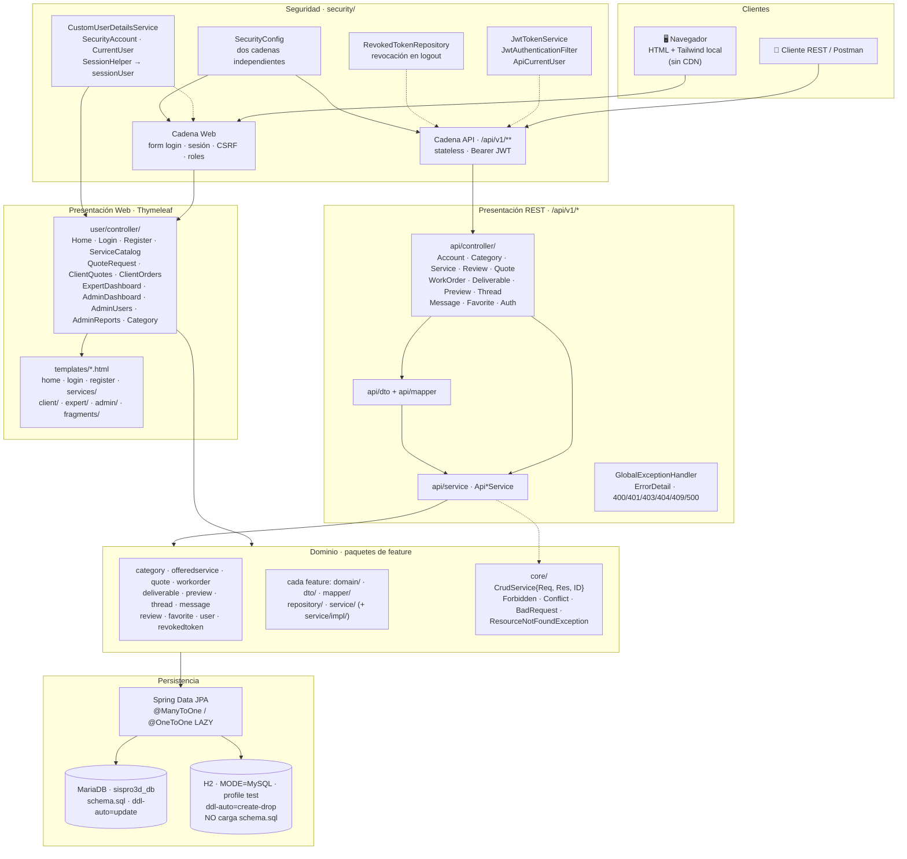
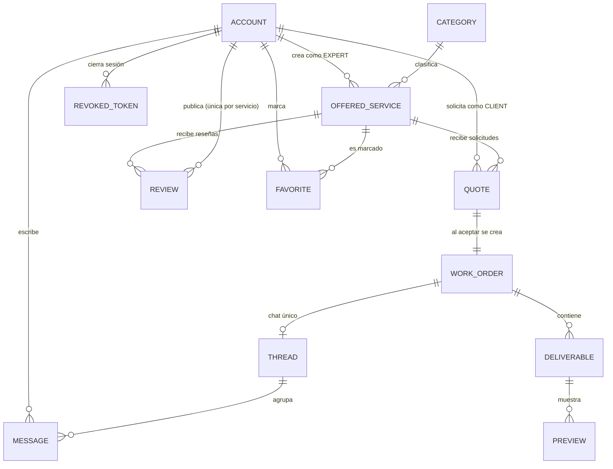

# Arquitectura de SISPRO3D

Visual del proyecto descrito en `AGENTS.md`, `requerimientos.md` y `README.md`.
Los diagramas son Mermaid y renderizan en GitHub, VS Code o `mermaid-cli`.

## 1. Diagrama de capas

> **Nota clave**: las dos presentaciones son **paralelas y no comparten** DTOs,
> servicios ni mappers. El código web usa controladores en `user/controller/` y
> servicios de dominio; la API usa `api/controller`, `api/service` (`Api*Service`)
> y `api/mapper`, que **delegan** en los mismos servicios de dominio.

## 2. Modelo de datos (relaciones principales)

| Entidad | Notas |
|---|---|
| `ACCOUNT` | usuarios con `Role` ADMIN / CLIENT / EXPERT; email = username |
| `OFFERED_SERVICE` | estatus `PENDING → APPROVED / REJECTED`, controlado por ADMIN |
| `QUOTE` | `PENDING → ACCEPTED / REJECTED / EXPIRED`; al aceptar crea la orden |
| `WORK_ORDER` | `PENDING → IN_PROGRESS → IN_REVIEW → COMPLETED`; cancelable antes de `IN_REVIEW` |
| `REVIEW` | requiere orden `COMPLETED`; `UNIQUE (id_client, id_offered_service)` |
| `FAVORITE` | entidad N:M cliente–servicio; su lógica vive en otros servicios |
| `REVOKED_TOKEN` | persistencia de refresh tokens invalidados (logout) |