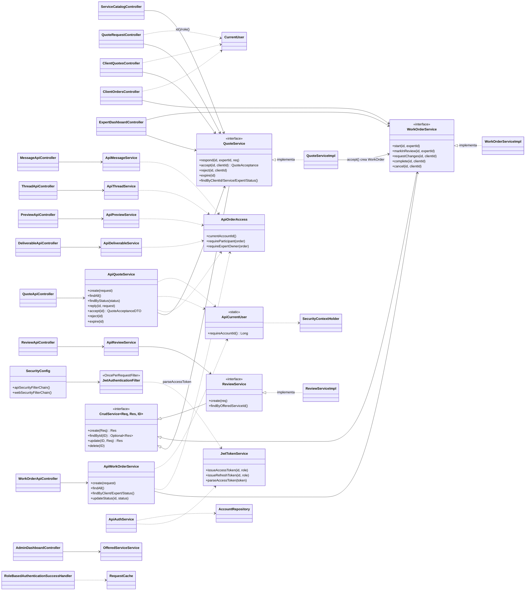
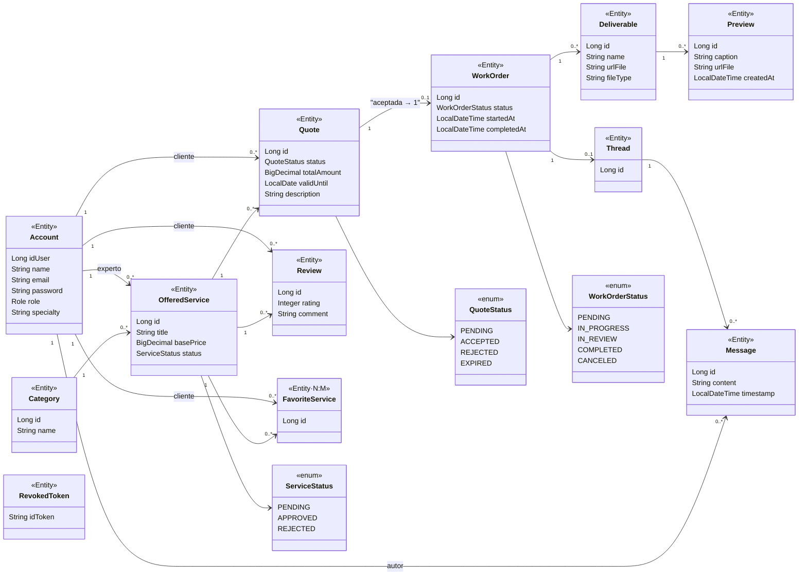
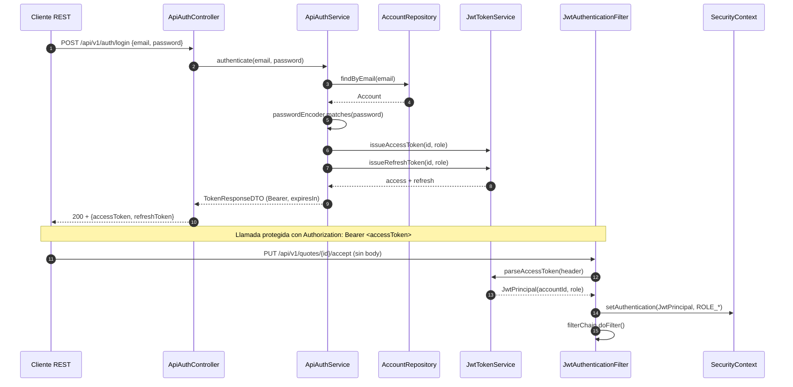
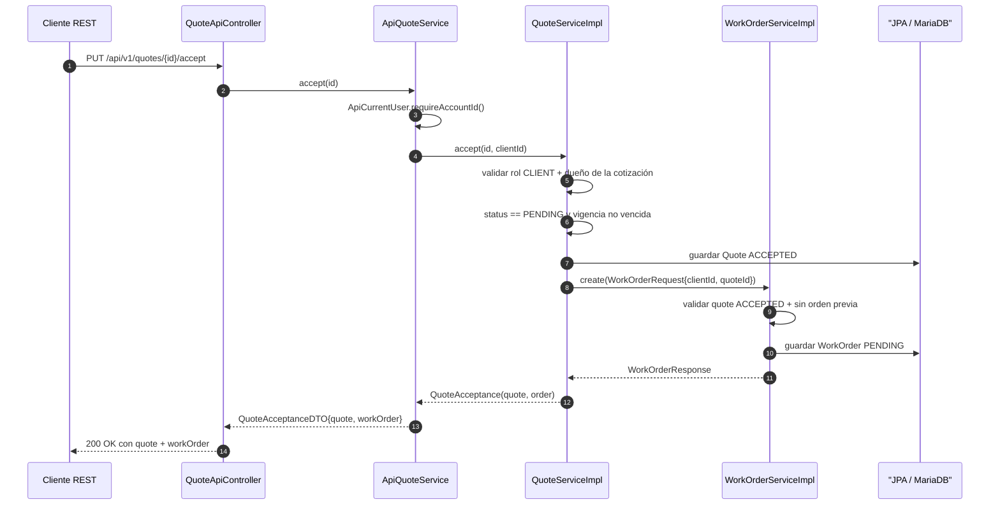
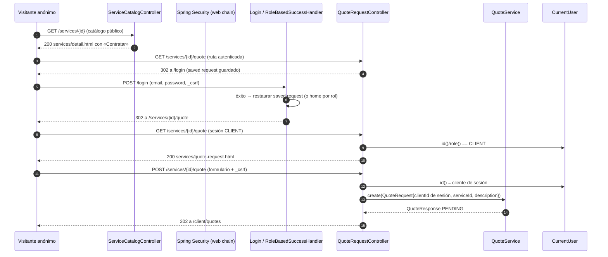
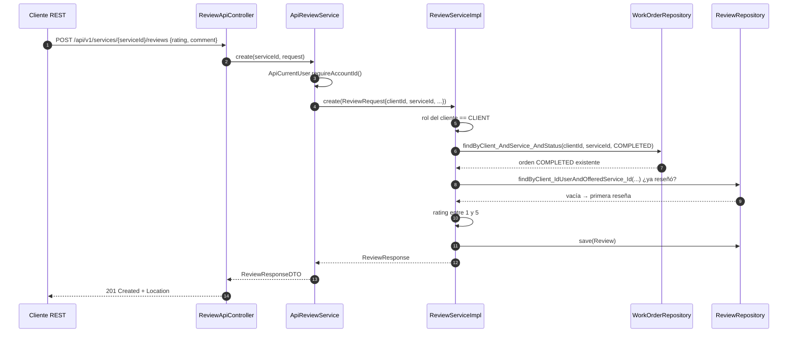
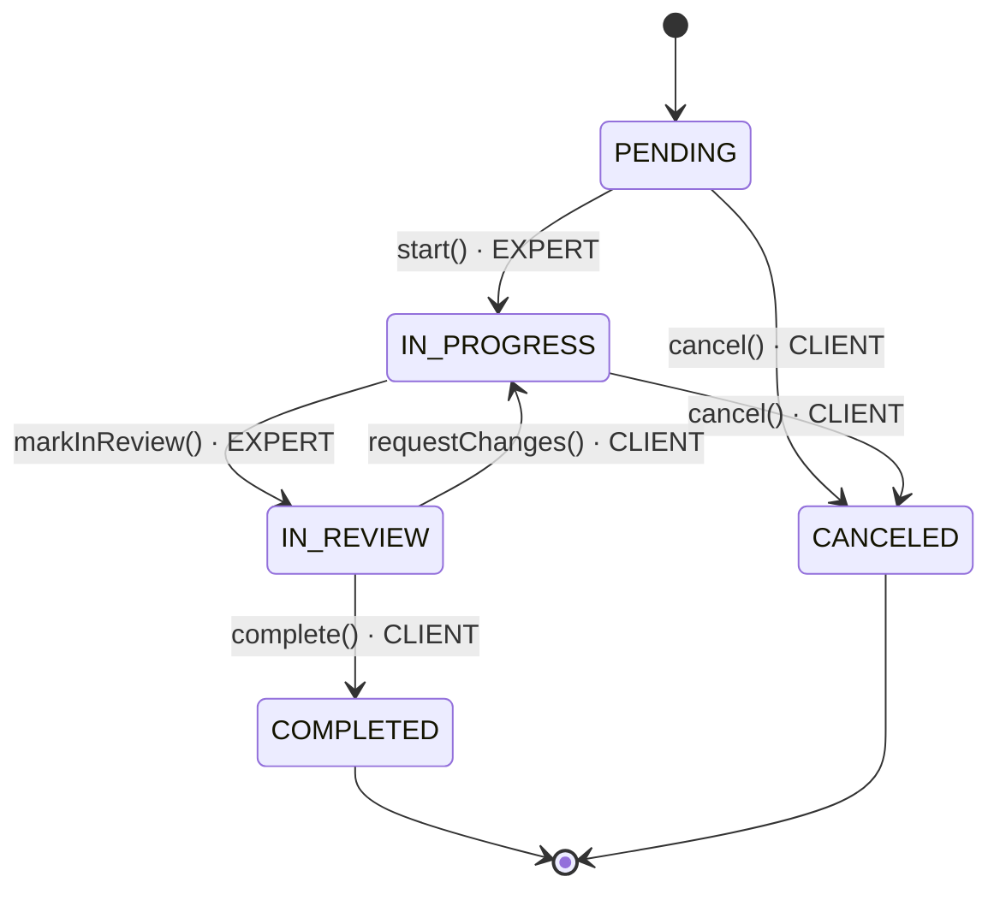
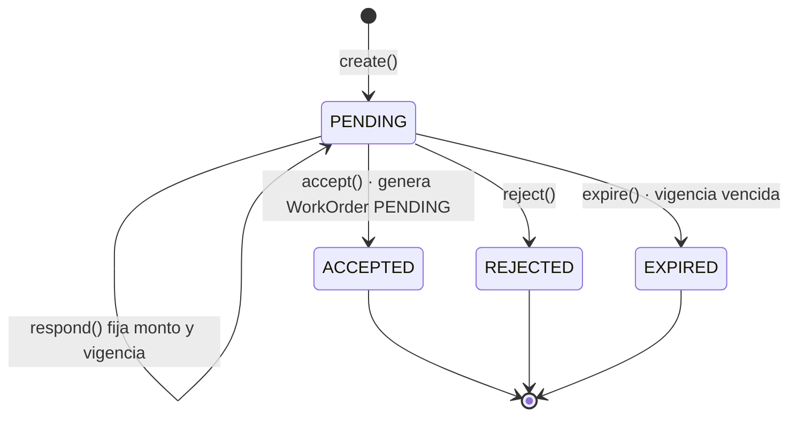
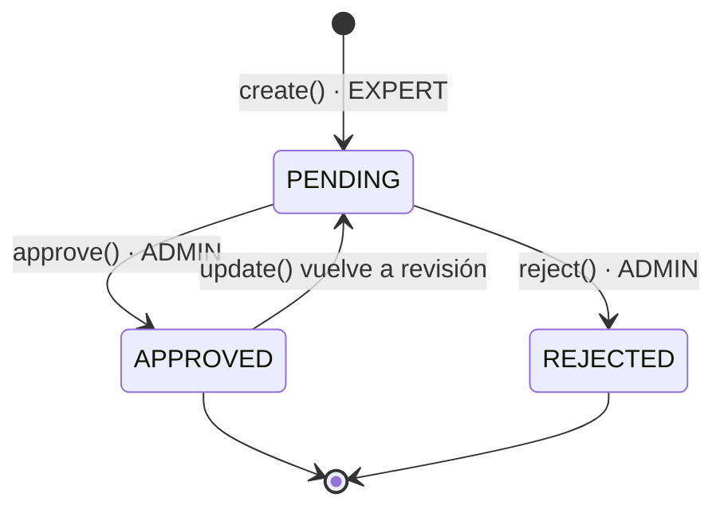

# Diagramas UML · SISPRO3D

Diagramas generados desde la implementación actual (`src/main/java`). Renderizan
en GitHub, VS Code o con `mermaid-cli`. Ver también `docs/architecture.md` para el
diagrama de capas y el modelo de datos.

## 1. Diagrama de clases

### 1.1 Capas de aplicación (presentaciones y dominio)



### 1.2 Entidades de dominio (JPA)



## 2. Diagramas de secuencia

### 2.1 Autenticación JWT y llamada protegida a la API



### 2.2 Aceptación de cotización (crea la orden)



### 2.3 Catálogo web: «Contratar» → login → formulario



### 2.4 Reseña: validación con orden COMPLETED



## 3. Diagramas de actividad

### 3.1 Ciclo de contratación (actividad)

```mermaid
flowchart TD
    Inicio([Cliente ve servicio APPROVED]) --> CTA{¿Puede contratar?}
    CTA -- Anónimo --> Login[[redirect a /login]]
    Login --> Form
    CTA -- EXPERT/ADMIN --> FinX([✗ rechazado por rol])
    CTA -- CLIENT --> Form[Formulario de solicitud<br/>/services/{id}/quote]

    Form --> Guardar{¿Servicio APPROVED?}
    Guardar -- No --> Err1[[400/404 · no se crea nada]]
    Guardar -- Sí --> CreaQuote[quote PENDING guardada]

    CreaQuote --> Reply{¿Experto del servicio?}
    Reply -- No --> Err2[[403 · solo el experto propietario]]
    Reply -- Sí --> Responde[quote responde: monto + vigencia<br/>sigue PENDING]

    Responde --> Decide{¿Cotización PENDING y vigente?}
    Decide -- Vencida --> Err3[[rechazada · vigencia expirada]]
    Decide -- Sí --> Acepta{Cliente decide}
    Acepta -- Rechazar --> Rej[quote REJECTED · fin]
    Acepta -- Aceptar --> Orden[quote ACCEPTED +<br/>WorkOrder PENDING creada]

    Orden --> Trans{WFS en orden}
    Trans --> P[PENDING → IN_PROGRESS<br/>inicia el EXPERT]
    Trans --> C1[CANCELED · cliente<br/>desde PENDING o IN_PROGRESS]
    P --> IR[IN_PROGRESS → IN_REVIEW<br/>entrega el EXPERT]
    IR --> C2[IN_REVIEW → IN_PROGRESS<br/>solicita cambios el CLIENT]
    IR --> Done[IN_REVIEW → COMPLETED<br/>aprueba el CLIENT]
    Done --> Review((cliente con orden COMPLETED<br/>puede dejar review))
```

### 3.2 Máquinas de estado

**Orden de trabajo**



**Cotización**



**Servicio (aprobación por ADMIN)**

